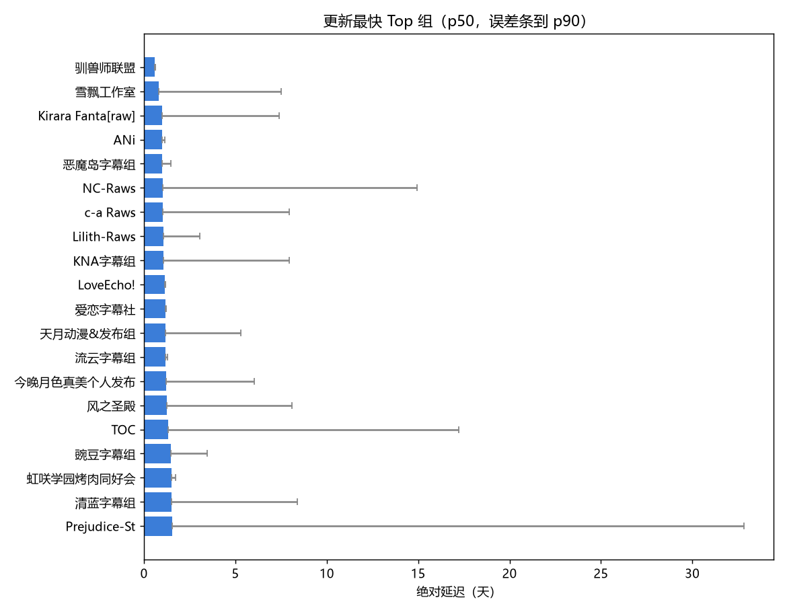
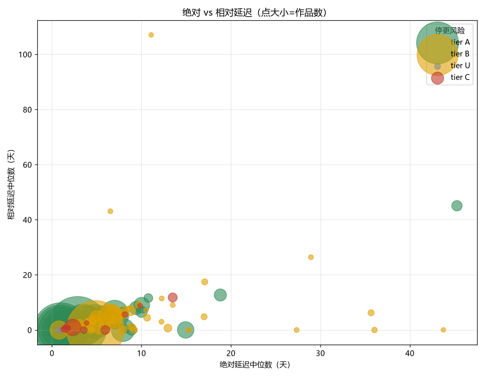
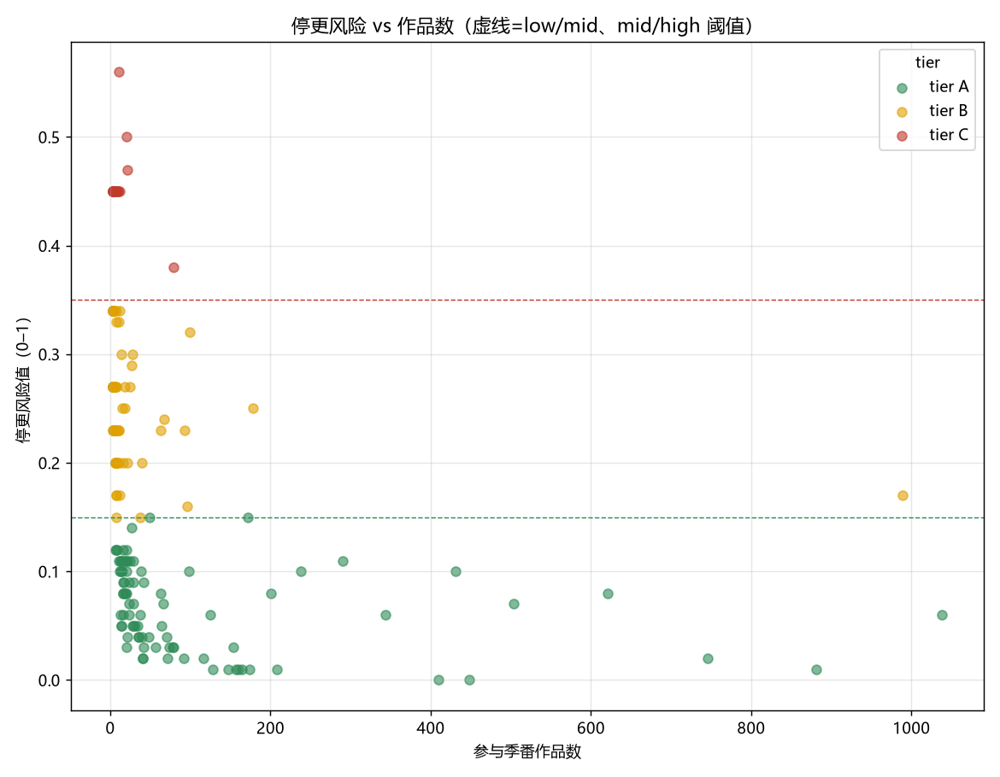
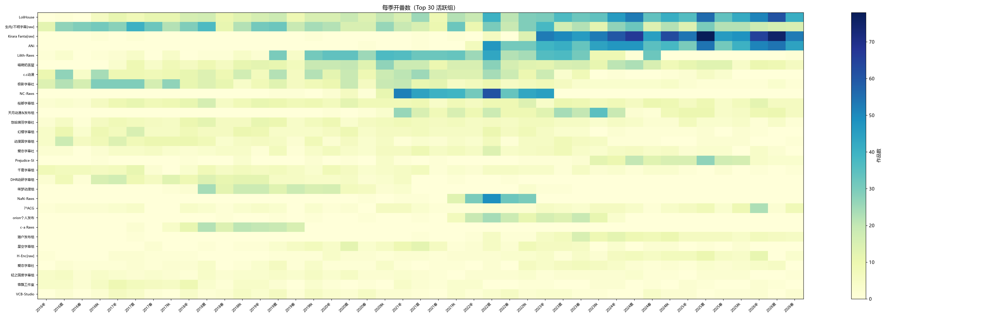
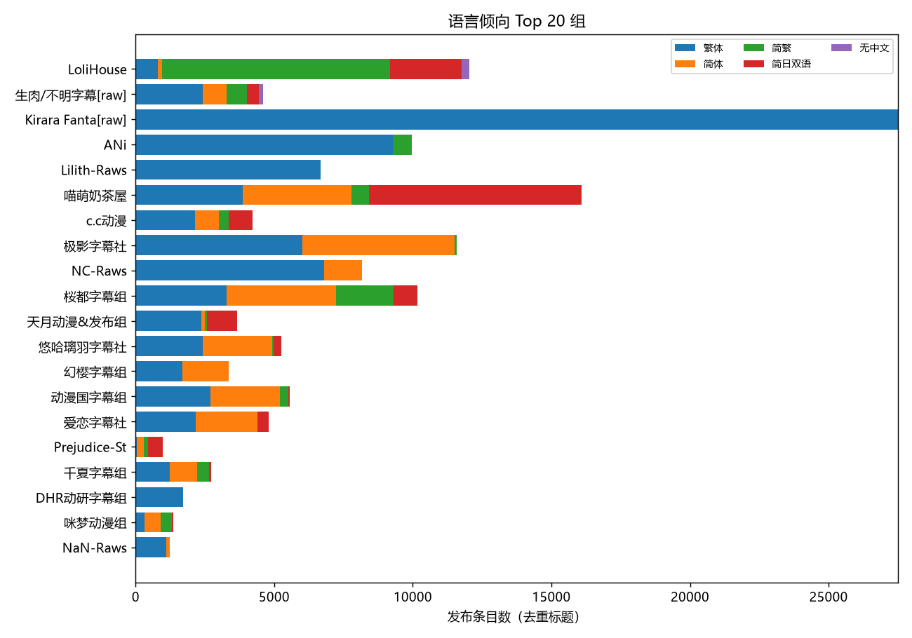

# 全站字幕组评估 2016–2026

- 活跃组（≥3 部季番）：**215** 个（其中生肉/未标注 **30** 个，已标注 `raw` 但保留在排行）
- 覆盖发布条目：**93386** 个可用于延迟计算的集
- 全站语言分布（按发布条目）：繁体 103235，简体 45455，简日双语 30396，简繁 17786，无中文 429

> 口径：绝对延迟=发布时刻 − Bangumi 放送日；相对延迟=同番最快显式中文组；风险沿用现有 `assess_risk`（弃番率 + 整组停更 + 接番意愿）。长番/非季番已排除。

## 摘要

- **产量最高**：LoliHouse（1038 部，25.32 部/季）。
- **更新最快**（绝对延迟中位数，≥20 集样本）：驯兽师联盟（14.02h，tier U）。
- **中文字幕组里的稳健选择**（tier A 且 ≥20 部，按绝对延迟升序）：ANi（23.52h）、NC-Raws（24.5h）、c-a Raws（24.6h）。
- **风险最高**：永恒solo（risk 0.56，high）；注意「速度快」与「不弃番」不等价。
- **语言盘面**（按发布条目）：繁体 103235、简体 45455、简日双语 30396；头部组普遍提供内封（软字幕）。

## 更新速度最快（绝对延迟中位数，需 ≥20 集样本）

| 字幕组 | 类型 | 作品数 | 绝对p50(h) | 绝对p90(h) | 相对p50(h) | 主语言 | tier |
| --- | --- | --- | --- | --- | --- | --- | --- |
| 驯兽师联盟 | 字幕 | 3 | 14.02 | 15.26 | 0.0 | 简日双语 | U |
| 雪飘工作室 | 字幕 | 96 | 19.3 | 180.35 | 0.0 | 繁体 | B |
| Kirara Fantasia | raw | 881 | 23.52 | 177.52 | -0.02 | 繁体 | A |
| ANi | 字幕 | 746 | 23.52 | 27.17 | 0.0 | 繁体 | A |
| 恶魔岛字幕组 | 字幕 | 11 | 24.03 | 35.47 | 0.0 | 简体 | A |
| NC-Raws | 字幕 | 410 | 24.5 | 358.52 | 0.0 | 繁体 | A |
| c-a Raws | 字幕 | 128 | 24.6 | 190.31 | 0.0 | 简体 | A |
| Lilith-Raws | 字幕 | 621 | 25.22 | 72.91 | 0.35 | 繁体 | A |
| KNA字幕组 | 字幕 | 16 | 25.5 | 190.45 | 0.0 | 繁体 | A |
| LoveEcho! | 字幕 | 4 | 27.08 | 28.57 | 1.87 | 繁体 | B |
| 爱恋字幕社 | 字幕 | 3 | 27.89 | 29.46 | 0.0 | 繁体 | B |
| 天月动漫&发布组 | 字幕 | 290 | 28.29 | 127.13 | 5.85 | 繁体 | A |
| 流云字幕组 | 字幕 | 3 | 28.32 | 30.48 | 0.0 | 繁体 | B |
| 今晚月色真美个人发布 | 字幕 | 7 | 28.72 | 145.02 | 2.07 | 简日双语 | A |
| 风之圣殿 | 字幕 | 37 | 30.17 | 194.13 | 2.17 | 简体 | A |

## 更新最慢

| 字幕组 | 作品数 | 绝对p50(h) | 相对p50(h) | 主语言 | tier |
| --- | --- | --- | --- | --- | --- |
| 波洛咖啡厅 | 29 | 1086.16 | 1081.83 | 简日双语 | A |
| Amor字幕组 | 6 | 865.04 | 0.0 | 简繁 | B |
| 芝士动物朋友 | 41 | 451.58 | 304.68 | 简繁 | A |
| 动漫萌 | 8 | 409.72 | 419.17 | 简体 | B |
| 红烧鱼字幕组 | 8 | 408.0 | 115.45 | 繁体 | B |
| 动漫先锋 | 3 | 366.73 | 0.0 | 简体 | B |
| 千夏字幕组 | 4 | 323.96 | 217.88 | 繁体 | B |
| 萌樱字幕组 | 21 | 323.83 | 283.1 | 简日双语 | C |
| 追放字幕组 | 15 | 310.93 | 16.75 | 繁体 | B |
| 光荣字幕组 | 4 | 293.82 | 71.63 | 简体 | B |

解读：绝对与相对延迟的中位数相关系数 **r=0.34**；生肉/未标注组平均绝对延迟 **229.2 h**，中文字幕组 **142.7 h**。绝对延迟=发布到官方放送日，相对延迟=同番里比最快组慢多少；两者都低说明既快又稳，绝对高而相对低多是分割季/平台源整体延后所致。

## 停更风险最高

| 字幕组 | 作品数 | risk | 等级 | tier | 置信度 | 最近发布(天) | 依据 |
| --- | --- | --- | --- | --- | --- | --- | --- |
| 永恒solo | 11 | 0.56 | high | C | medium | 137.61 | 最近 7 部已完结作品中有 4 部疑似弃番；历史作品最近一次发布在 138 天前，但该组仍在接新番 |
| 黑白字幕组 | 20 | 0.5 | high | C | high | 24.95 | 最近 8 部已完结作品中有 4 部疑似弃番；历史作品最近一次发布在 25 天前，但该组仍在接新番 |
| 萌樱字幕组 | 21 | 0.47 | high | C | high | 83.91 | 最近 13 部已完结作品中有 6 部疑似弃番；历史作品最近一次发布在 84 天前，但该组仍在接新番 |
| PorterRAWS | 12 | 0.45 | high | C | low | 387.95 | 最近 1 部已完结作品中有 0 部疑似弃番；全组已 388 天没有任何发布，且最近两季未接新番（疑似整组停更）；最近两季未接任何新番；历史作品全部正常完结 |
| 极彩字幕组 | 10 | 0.45 | high | C | low | 239.63 | 最近 1 部已完结作品中有 0 部疑似弃番；全组已 240 天没有任何发布，且最近两季未接新番（疑似整组停更）；最近两季未接任何新番；历史作品全部正常完结 |
| 梦蓝字幕组 | 10 | 0.45 | high | C | low | 365.27 | 最近 1 部已完结作品中有 0 部疑似弃番；全组已 365 天没有任何发布，且最近两季未接新番（疑似整组停更）；最近两季未接任何新番；历史作品全部正常完结 |
| 千夏字幕组 | 9 | 0.45 | high | C | low | 894.05 | 最近 1 部已完结作品中有 0 部疑似弃番；全组已 894 天没有任何发布，且最近两季未接新番（疑似整组停更）；最近两季未接任何新番；历史作品全部正常完结 |
| 雷电字幕组 | 7 | 0.45 | high | C | low | 2037.87 | 最近 1 部已完结作品中有 0 部疑似弃番；全组已 2038 天没有任何发布，且最近两季未接新番（疑似整组停更）；最近两季未接任何新番；历史作品全部正常完结 |
| QS-Raws | 5 | 0.45 | high | C | low | 2578.08 | 最近 1 部已完结作品中有 0 部疑似弃番；全组已 2578 天没有任何发布，且最近两季未接新番（疑似整组停更）；最近两季未接任何新番；历史作品全部正常完结 |
| 小愿8压制组 | 5 | 0.45 | high | C | low | 3116.27 | 最近 1 部已完结作品中有 0 部疑似弃番；全组已 3116 天没有任何发布，且最近两季未接新番（疑似整组停更）；最近两季未接任何新番；历史作品全部正常完结 |

解读：tier C 为高风险，且风险优先于速度——「更新快」不等于「不弃番」；高产又低风险的 tier A 组才是追更首选。

## 产量最高

| 字幕组 | 类型 | 作品数 | 部/季 | 单季峰值 | 主语言 | 内封% | tier |
| --- | --- | --- | --- | --- | --- | --- | --- |
| LoliHouse | 字幕 | 1038 | 25.32 | 61 | 简繁 | 99.5 | A |
| 生肉/不明字幕 | raw | 989 | 23.0 | 40 | 繁体 | 73.4 | B |
| Kirara Fantasia | raw | 881 | 40.05 | 78 | 繁体 | 100.0 | A |
| ANi | 字幕 | 746 | 35.52 | 54 | 繁体 | 100.0 | A |
| Lilith-Raws | 字幕 | 621 | 18.82 | 43 | 繁体 | 100.0 | A |
| 喵萌奶茶屋 | 字幕 | 504 | 12.92 | 28 | 简日双语 | 94.5 | A |
| c.c动漫 | 字幕 | 448 | 12.44 | 27 | 繁体 | 0.2 | A |
| 极影字幕社 | 字幕 | 431 | 10.02 | 29 | 繁体 | 8.6 | A |
| NC-Raws | 字幕 | 410 | 27.33 | 61 | 繁体 |  | A |
| 桜都字幕组 | 字幕 | 343 | 7.98 | 16 | 简体 | 32.6 | A |
| 天月动漫&发布组 | 字幕 | 290 | 11.15 | 35 | 繁体 | 95.1 | A |
| 悠哈璃羽字幕社 | 字幕 | 238 | 5.53 | 12 | 简体 | 32.0 | A |
| 幻樱字幕组 | 字幕 | 208 | 5.33 | 15 | 繁体 |  | A |
| 动漫国字幕组 | 字幕 | 201 | 5.15 | 18 | 繁体 | 100.0 | A |
| 爱恋字幕社 | 字幕 | 178 | 4.45 | 14 | 简体 | 0.0 | B |

解读：产量头部为 LoliHouse（25.32 部/季）、生肉/不明字幕（23.0 部/季）、Kirara Fantasia（40.05 部/季），多为 raw/批量组，靠「全季多开 + 当日出片」同时拿下速度与产量；普通中文字幕组多为 1–12 部/季。

## 语言倾向

解读：全站以繁体为最大盘，简体与简日双语次之；头部组普遍提供内封（软字幕），语言偏好分化明显（简繁内封 / 简日双语 / 繁体）。

## 已知限制

- 集号体系不同者已用 ordinal 锚定；仍可能有极端长番残余误差。
- 语言判定默认繁体（inferred），与显式标注分开统计，概览仍可能高估繁体。
- 活跃定义为窗口内 ≥3 部季番；低频组样本少，confidence=low 时不下风险结论。
- 生肉/未标注组保留在排行但标注 `raw`；相对延迟基线只取显式中文字幕组，raw 不进基线。
- 绝对延迟仅统计覆盖该番过半集数的作品，已排除合集/单集噪声；以合集收尾的组会被记作「已完成」，但每周只更到中途再转批量的组仍可能被判疑似弃番。
- 本报告样本：窗口 2016–2026；补全更长窗口只需重跑 seasons→anime→deep→schedule。
