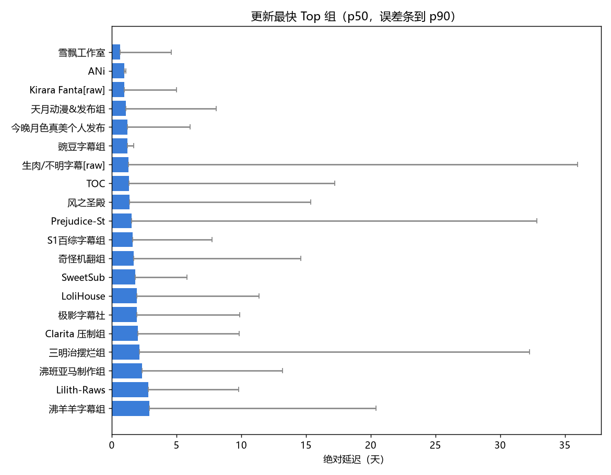
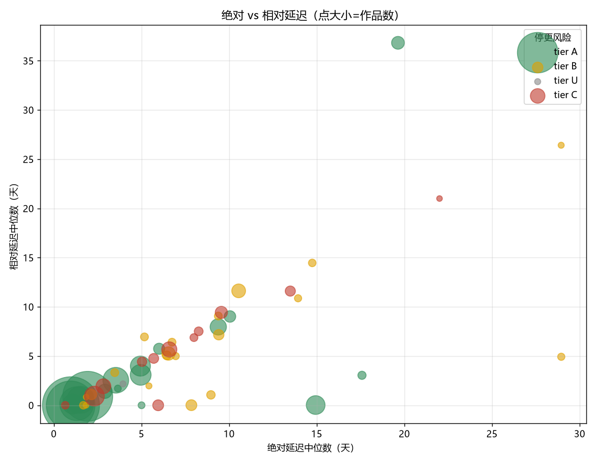
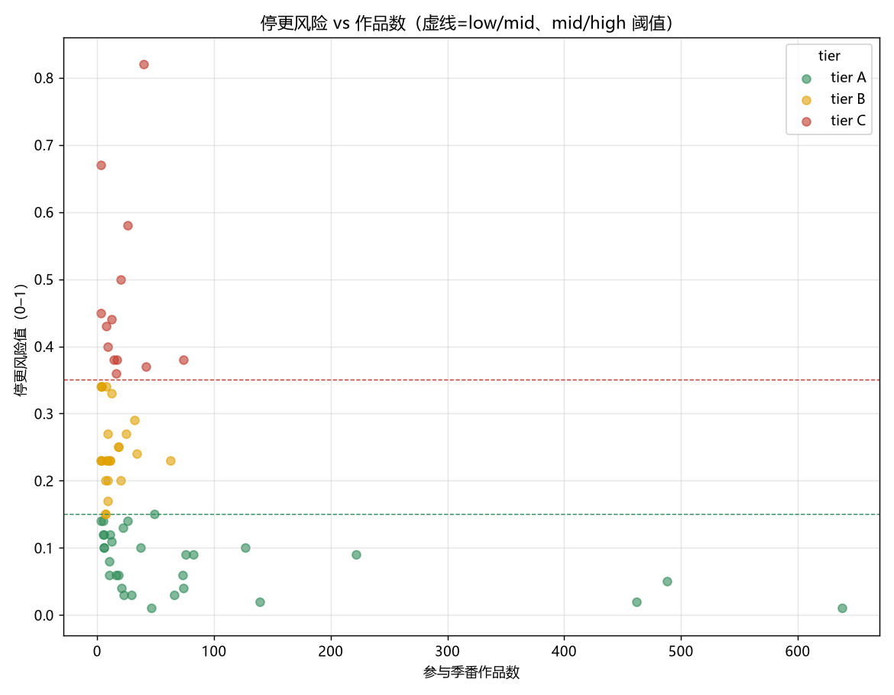
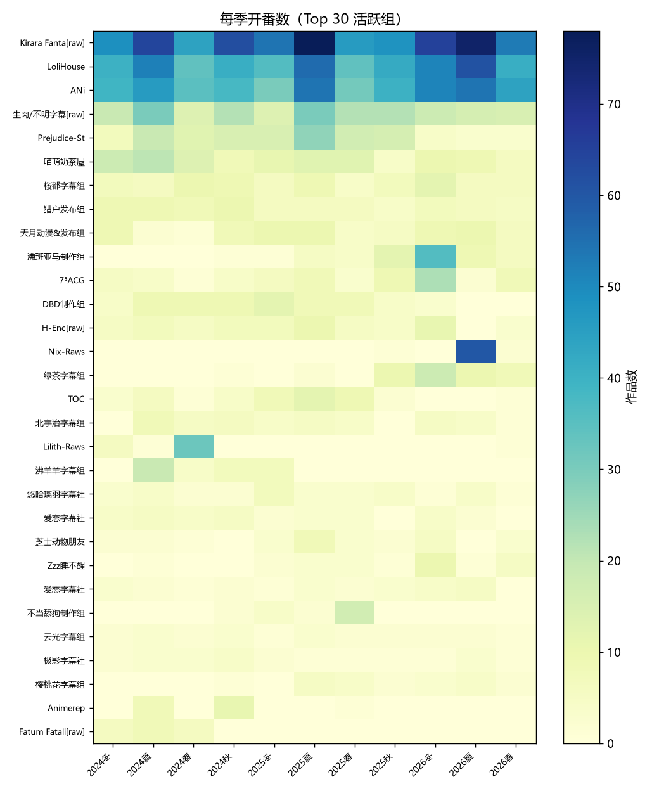
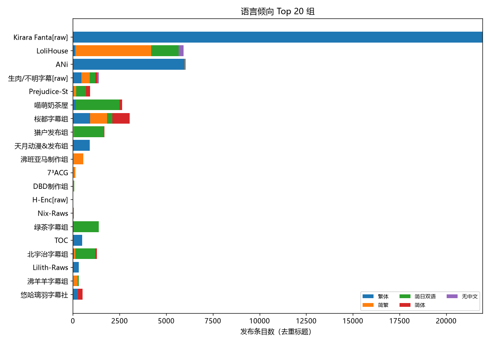

# 全站字幕组评估 2024–2026

- 活跃组（≥3 部季番）：**77** 个（其中生肉/未标注 **7** 个，已标注 `raw` 但保留在排行）
- 覆盖发布条目：**29017** 个可用于延迟计算的集
- 全站语言分布（按发布条目）：繁体 33849，简日双语 13087，简繁 7284，简体 4124，无中文 337

> 口径：绝对延迟=发布时刻 − Bangumi 放送日；相对延迟=同番最快显式中文组；风险沿用现有 `assess_risk`（弃番率 + 整组停更 + 接番意愿）。长番/非季番已排除。

## 摘要

- **头部格局**：raw/批量组（Kirara Fantasia、LoliHouse、ANi）在产量与速度上双领先；其中 raw 组不进相对延迟基线。
- **中文字幕组里的稳健选择**：LoliHouse（简繁内封，绝对 ~46h）、喵萌奶茶屋、桜都、猎户、天月等，产量中等且 tier A。
- **速度与风险不等价**：雪飘工作室最快但 tier C；Lilith-Raws、爱恋字幕社、黑白字幕组历史弃番率偏高，追更需谨慎。
- **语言盘面**：繁体仍是最大盘，简日双语次之；头部组普遍提供内封（软字幕）。

## 更新速度最快（绝对延迟中位数，需 ≥20 集样本）

| 字幕组 | 类型 | 作品数 | 绝对p50(h) | 绝对p90(h) | 相对p50(h) | 主语言 | tier |
| --- | --- | --- | --- | --- | --- | --- | --- |
| 雪飘工作室 | 字幕 | 8 | 15.68 | 110.49 | 0.0 | 繁体 | C |
| ANi | 字幕 | 462 | 23.05 | 25.95 | 0.0 | 繁体 | A |
| Kirara Fantasia | raw | 638 | 23.5 | 119.58 | -0.02 | 繁体 | A |
| 天月动漫&发布组 | 字幕 | 74 | 25.82 | 193.42 | 2.9 | 繁体 | A |
| 今晚月色真美个人发布 | 字幕 | 5 | 28.72 | 145.02 | 2.07 | 简日双语 | A |
| 豌豆字幕组 | 字幕 | 10 | 29.32 | 40.08 | 2.42 | 繁体 | A |
| 生肉/不明字幕 | raw | 222 | 31.28 | 863.51 | 3.75 | 繁体 | A |
| TOC | 字幕 | 46 | 31.95 | 412.98 | 0.0 | 繁体 | A |
| 风之圣殿 | 字幕 | 5 | 32.84 | 368.7 | 3.72 | 简体 | A |
| Prejudice-Studio | 字幕 | 139 | 36.61 | 787.71 | 13.4 | 简日双语 | A |
| S1百综字幕组 | 字幕 | 11 | 38.33 | 185.44 | 0.07 | 简体 | A |
| 奇怪机翻组 | 字幕 | 8 | 40.46 | 350.65 | 0.0 | 简日双语 | B |
| SweetSub | 字幕 | 18 | 43.48 | 138.99 | 24.28 | 简日双语 | A |
| LoliHouse | 字幕 | 488 | 46.43 | 272.99 | 21.87 | 简繁 | A |
| 极影字幕社 | 字幕 | 22 | 46.48 | 237.43 | 23.8 | 简体 | A |

## 更新最慢

| 字幕组 | 作品数 | 绝对p50(h) | 相对p50(h) | 主语言 | tier |
| --- | --- | --- | --- | --- | --- |
| FSD粉羽社 | 7 | 694.83 | 118.23 | 繁体 | B |
| 动漫国字幕组 | 10 | 421.96 | 73.07 | 简体 | A |
| 新Sub | 8 | 353.87 | 347.07 | 简日双语 | B |
| 诸神字幕组 | 7 | 334.45 | 260.9 | 简日双语 | B |
| 萌樱字幕组 | 17 | 323.83 | 278.44 | 简日双语 | C |
| 悠哈璃羽字幕社 | 34 | 253.12 | 278.98 | 简体 | B |
| 云光字幕组 | 23 | 241.18 | 216.52 | 简体 | A |
| 爱恋字幕社 | 26 | 229.4 | 226.43 | 繁体 | C |
| 拨雪寻春 | 18 | 225.87 | 171.96 | 简日双语 | B |
| 离谱Sub | 9 | 225.25 | 217.61 | 简日双语 | B |

解读：绝对与相对延迟的中位数相关系数 **r=0.74**；生肉/未标注组平均绝对延迟 **61.7 h**，中文字幕组 **165.0 h**。绝对延迟=发布到官方放送日，相对延迟=同番里比最快组慢多少；两者都低说明既快又稳，绝对高而相对低多是分割季/平台源整体延后所致。

## 停更风险最高

| 字幕组 | 作品数 | risk | 等级 | tier | 置信度 | 最近发布(天) | 依据 |
| --- | --- | --- | --- | --- | --- | --- | --- |
| Lilith-Raws | 40 | 0.82 | high | C | high | 118.25 | 最近 36 部已完结作品中有 30 部疑似弃番；历史作品最近一次发布在 118 天前，但该组仍在接新番 |
| 永恒solo | 3 | 0.67 | high | C | low | 137.27 | 最近 1 部已完结作品中有 1 部疑似弃番；历史作品最近一次发布在 137 天前，但该组仍在接新番 |
| 爱恋字幕社 | 26 | 0.58 | high | C | high | 4.0 | 最近 10 部已完结作品中有 6 部疑似弃番 |
| 黑白字幕组 | 20 | 0.5 | high | C | high | 24.61 | 最近 8 部已完结作品中有 4 部疑似弃番；历史作品最近一次发布在 25 天前，但该组仍在接新番 |
| 风之圣殿字幕组 | 3 | 0.45 | high | C | low | 138.76 | 最近 1 部已完结作品中有 0 部疑似弃番；全组已 139 天没有任何发布，且最近两季未接新番（疑似整组停更）；最近两季未接任何新番；历史作品全部正常完结 |
| 千夏字幕组 | 12 | 0.44 | high | C | medium | 75.91 | 最近 7 部已完结作品中有 3 部疑似弃番；历史作品最近一次发布在 76 天前，但该组仍在接新番 |
| 雪飘工作室 | 8 | 0.43 | high | C | medium | 0.06 | 最近 5 部已完结作品中有 2 部疑似弃番 |
| TSDM字幕组 | 9 | 0.4 | high | C | medium | 4.52 | 最近 3 部已完结作品中有 1 部疑似弃番 |
| 沸班亚马制作组 | 74 | 0.38 | high | C | high | 3.26 | 最近 11 部已完结作品中有 4 部疑似弃番 |
| 萌樱字幕组 | 17 | 0.38 | high | C | high | 83.58 | 最近 11 部已完结作品中有 4 部疑似弃番；历史作品最近一次发布在 84 天前，但该组仍在接新番 |

解读：tier C 为高风险，且风险优先于速度——速度快不等于不弃番（如雪飘工作室更新最快但历史弃番率偏高，被列为 tier C）；高产又低风险的 tier A 组才是追更首选。

## 产量最高

| 字幕组 | 类型 | 作品数 | 部/季 | 单季峰值 | 主语言 | 内封% | tier |
| --- | --- | --- | --- | --- | --- | --- | --- |
| Kirara Fantasia | raw | 638 | 58.0 | 78 | 繁体 | 100.0 | A |
| LoliHouse | 字幕 | 488 | 44.36 | 61 | 简繁 | 100.0 | A |
| ANi | 字幕 | 462 | 42.0 | 54 | 繁体 | 100.0 | A |
| 生肉/不明字幕 | raw | 222 | 20.18 | 30 | 繁体 | 63.9 | A |
| Prejudice-Studio | 字幕 | 139 | 12.64 | 27 | 简日双语 | 13.5 | A |
| 喵萌奶茶屋 | 字幕 | 127 | 11.55 | 21 | 简日双语 | 100.0 | A |
| 桜都字幕组 | 字幕 | 82 | 7.45 | 12 | 繁体 | 33.2 | A |
| 猎户发布组 | 字幕 | 76 | 6.91 | 10 | 简日双语 | 4.4 | A |
| 天月动漫&发布组 | 字幕 | 74 | 6.73 | 10 | 繁体 | 100.0 | A |
| 沸班亚马制作组 | 字幕 | 74 | 9.25 | 36 | 简繁 | 100.0 | C |
| 7³ACG | 字幕 | 73 | 6.64 | 23 | 简繁 |  | A |
| DBD制作组 | 字幕 | 66 | 7.33 | 12 | 简日双语 | 69.6 | A |
| H-Enc | raw | 64 | 6.4 | 11 |  |  | A |
| Nix-Raws | 字幕 | 63 | 21.0 | 60 | 简繁 | 100.0 | B |
| 绿茶字幕组 | 字幕 | 49 | 8.17 | 18 | 简日双语 | 31.8 | A |

解读：产量头部由 raw/批量组占据（Kirara Fantasia 58 部/季、LoliHouse 44、ANi 42），它们靠「全季多开 + 当日出片」同时拿下速度与产量；中文字幕组多为 3–12 部/季。

## 语言倾向

解读：全站以繁体为最大盘，简日双语次之。`LoliHouse`/`Nix-Raws` 主打简繁内封，`喵萌`/`猎户`/`DBD` 主打简日双语，`ANi`/`Kirara` 为繁体；头部组内封（软字幕）几乎默认。

## 已知限制

- 集号体系不同者已用 ordinal 锚定；仍可能有极端长番残余误差。
- 语言判定默认繁体（inferred），与显式标注分开统计，概览仍可能高估繁体。
- 活跃定义为窗口内 ≥3 部季番；低频组样本少，confidence=low 时不下风险结论。
- 生肉/未标注组保留在排行但标注 `raw`；相对延迟基线只取显式中文字幕组，raw 不进基线。
- 绝对延迟仅统计覆盖该番过半集数的作品，已排除合集/单集噪声；以合集收尾的组会被记作「已完成」，但每周只更到中途再转批量的组仍可能被判疑似弃番。
- 本报告样本：窗口 2024–2026；补全更长窗口只需重跑 seasons→anime→deep→schedule。
